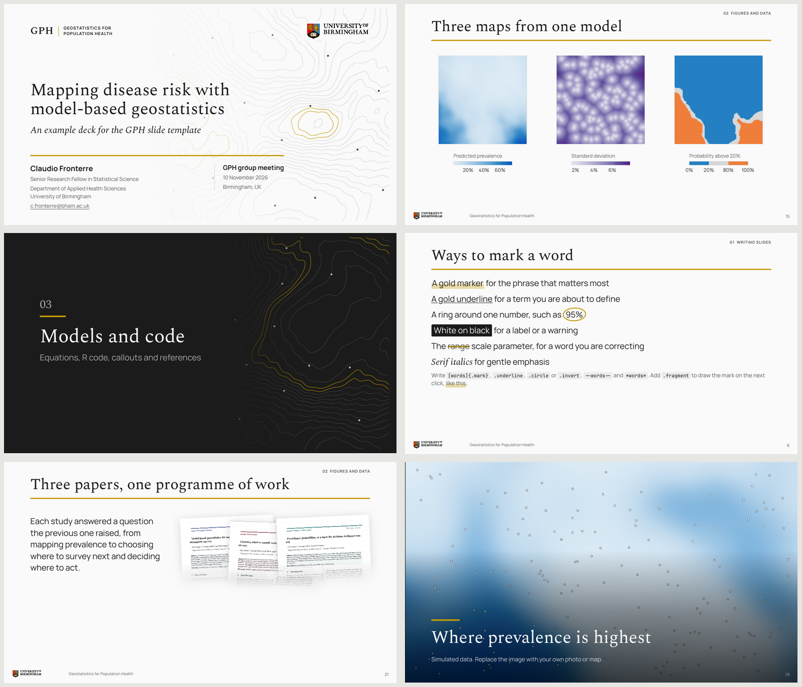

# GPH slides

A Quarto revealjs template for talks by the Geostatistics for Population Health group. It gives every deck the same clean look (Spectral headings over a gold rule, Manrope text, the University of Birmingham palette) and a set of layouts for the slides we make most often, from maps and variograms to model equations and R code.



The title, section and closing slides carry a contour motif. It is a single realisation of a Gaussian process with Matérn correlation, drawn as isolines with a few sampling locations, made by `tools/motif.R`.

## Start a new talk

From the folder where the talk should live, run

```bash
quarto use template claudiofronterre/gph-slides
```

Quarto asks for a directory name, installs the extension and copies the example deck, renamed after the directory, together with `R/gph-theme.R`, `references.bib`, the logo in `assets/` and the example images in `assets/examples/`, which can be deleted once the example slides are gone. Edit the YAML header and replace the example slides with your own. Render with

```bash
quarto render my-talk.qmd
```

The result is one self-contained HTML file that can be emailed, opened offline or presented from a USB stick. Press <kbd>S</kbd> for the speaker view, <kbd>F</kbd> for full screen and <kbd>O</kbd> for an overview of all slides.

To use the format in an existing project instead, run

```bash
quarto add claudiofronterre/gph-slides
```

and set `format: gph-revealjs` in the document header.

You need Quarto 1.5 or later. The example figures need R with ggplot2 and scales. The ragg package is recommended, because it lets plots use the slide font.

## The title slide

The title slide is built from the YAML header.

```yaml
title: "Mapping disease risk with model-based geostatistics"
subtitle: "An example deck for the GPH slide template"
author:
  - name: Claudio Fronterre
    position: Senior Research Fellow in Statistical Science
    email: c.fronterre@bham.ac.uk
    affiliations:
      - name: University of Birmingham
        department: Department of Applied Health Sciences
event: "GPH group meeting"
location: "Birmingham, UK"
date: today
title-logos:
  - src: assets/uob-logo.svg
    alt: University of Birmingham
format:
  gph-revealjs:
    logo: assets/uob-logo.svg
    footer: "Geostatistics for Population Health"
```

Every field except `title` is optional. Several authors sit side by side. `title-logos` takes any number of logos for the top right corner, so partner institutions can be added there, and `logo` is the small logo shown at the bottom of content slides. Set `group-short` and `group-name` to change the wordmark in the top left corner.

## Writing slides

A level-2 heading (`##`) starts a slide and a level-1 heading (`#`) starts a numbered section. Text under a section heading appears on the section slide as a short description. Everything else is ordinary Quarto Markdown, so columns, incremental lists, speaker notes, callouts, tabsets and citations all work as usual. The example deck shows each of them, with comments in the source explaining the syntax.

The extension adds these classes.

| Class | Use it on | Effect |
|:------|:----------|:-------|
| `.lead` | a div | Larger opening sentence |
| `.takeaway` | a div | Key message with a gold bar. Add `.bottom` to pin it to the foot of the slide |
| `.statement` | a slide heading | One large message in the middle of the slide |
| `.stats` | a div of paragraphs | Each paragraph becomes a key figure. The first bold text is set large. Add `.large` for one headline number |
| `.steps` | a div around a numbered list | Numbered rows with descriptions. Add `.horizontal` to lay them side by side |
| `.cards` | a div of divs | Short items in a grid. Mark one with `.accent` to give it a gold rule |
| `.equation`, `.terms` | divs | A display equation and a two-column reading of its terms |
| `.mark` | a span | A gold marker behind the phrase that matters most. Add a colour, as in `[Forest]{.mark .turquoise}`, to tint it to match a figure |
| `.underline`, `.circle`, `.invert` | a span | A gold underline, a gold ring around a number, or white on black |
| `~~text~~`, `*text*` | text | Struck through with a gold line, or set in serif italics |
| `.fragment` with a mark | a span | The mark is drawn on the next click while the words stay in place |
| `.key` with a colour | a span | A colour swatch that ties text to a figure, as in `[Forest]{.key .turquoise}` |
| `.v-center`, `.divided` | a columns div | Align columns on their middles, or separate them with a line |
| `.fill` | a div around one image | The image fills the space below the title |
| `.framed` | an image | Thin border, useful for screenshots |
| `.logo-row` | a div of images | Partner or funder logos in a row |
| `.caption`, `.small`, `.source` | a div or span | Grey metadata text. `.source` pins a source line to the bottom of the slide |
| `.no-title` | a slide heading | Hides the title bar but keeps the heading for navigation |
| `.closing` | a slide heading | The closing slide with the contour motif |
| `.outline` | a slide heading | Filled with the numbered sections and their descriptions. A later outline highlights the section that follows it |
| `.photo` | a slide heading with `background-image` | The image fills the slide and the title sits over a dark gradient. A paragraph after the title becomes a credit line |
| `.papers` | a div of images or PDFs | The top half of each first page, fading out. Add `.third` or `.full` to show more or less, or `.stack` to fan the pages out |
| `.people` | a div around a list | A grid of people. Each item is ` **Name** Role`, and without a photo the initials are shown |
| `.unnumbered` | a section heading | A section slide without a number |
| `.dark` | a section, statement or closing heading | White text on the brand black, with a dark contour motif |
| `.backup` | a section heading | Starts the backup slides, which are left out of the slide count |

Set `section-numbers: false` in the header to drop all section numbers, and `section-label: true` to show the current section in the top right corner of each content slide.

### Papers

Point `.papers` at the PDF of a paper and the first page is saved next to it as `<name>-page1.png` the first time the slides are rendered. The conversion uses `pdftoppm` from poppler when it is installed and otherwise the pdftools R package. Delete the PNG to make it again. Captions under the pages come from the image text, which can hold a citation.

```markdown
::: {.papers}


:::
```

### QR codes

`` draws a QR code for an address. It is made when the slides are rendered, so it needs no internet connection and appears in printed PDFs. On a closing slide it sits on the right. Put the address in quotes if it contains an equals sign, and add `size="220px"` to change its width.

### Code that builds up

Add `code-line-numbers: "|1-3|5-11"` to a chunk shown with `echo: true` to highlight those lines one click at a time. This is a Quarto feature and the example deck uses it on the code slide.

## Figures from R

`R/gph-theme.R` provides a ggplot2 theme and colour scales that match the slides. Source it in a setup chunk.

```r
source("R/gph-theme.R")
theme_set(theme_gph())
```

It provides

| Function | What it does |
|:---------|:-------------|
| `theme_gph()` | Minimal theme in the slide font, with a transparent background and horizontal grid lines only |
| `theme_gph_map()` | The same for maps, without axes or grid. `legend = "bottom"` puts the colour bar under the map, for maps side by side |
| `scale_colour_gph()`, `scale_fill_gph()` | The seven brand data colours for groups, in a fixed order |
| `scale_colour_gph_highlight("Forest")` | The named groups in colour and every other group in light grey, for the slide about one group |
| `scale_colour_gph_c()`, `scale_fill_gph_c()` | Continuous colours. Sequential by default in brand blue, or any brand hue with `hue = "purple"`. `type = "diverging"` runs from blue through grey to orange around a `midpoint`, and takes two hues |
| `scale_colour_gph_exceedance()`, `scale_fill_gph_exceedance()` | Exceedance probabilities in classes, by default below 20% (blue), 20% to 80% (grey) and above 80% (orange). Set `cutoffs` for other classes |
| `gph_colours`, `gph_ramp()`, `gph_diverging_ramp()`, `gph_tint()` | The colours themselves, for manual use |

The `_fill_` and `_colour_` versions of each scale work the same way. Sourcing the file also registers the Manrope font from the extension and, when the ragg package is installed, renders chunks with transparent backgrounds so that plots sit on the slide colour.

The categorical colours follow the order turquoise, orange, purple, red, blue, green and pink. The order was checked for colour vision deficiency, and any four of the first colours stay distinct for the common types. With five or more groups, label lines or points directly, and beyond seven use facets. Each sequential ramp is made of the brand's 15%, 30%, 50% and 70% tints of one colour, its light swatch and its deep swatch, and gets darker at every step. Giving each quantity its own hue, such as blue for predicted prevalence and purple for its standard deviation, lets the audience tell maps apart before reading the legends. The example deck shows this on the slide with three maps from one model.

## PDF copies

Open the rendered HTML in Chrome or Edge with `?print-pdf` at the end of the address, for example `file:///path/to/my-talk.html?print-pdf`, wait until the slides have loaded and print to PDF with margins set to none and background graphics switched on. Each slide becomes one page, with the logo, footer and slide number on content pages only. [decktape](https://github.com/astefanutti/decktape) is a command-line alternative.

## Design notes

The design follows the University of Birmingham [colour](https://brand.birmingham.ac.uk/guidelines/colour/) and [typography](https://brand.birmingham.ac.uk/guidelines/typography/) guidelines. Black and white dominate. Gold is used only for rules and other block graphics, and the secondary palette is kept for data, keys and infographics rather than running text or large blocks of background colour. Dark slides therefore use only black, white and gold, and tinted markers stay at 40%, below the 50% limit for black text on a tint. Headings use Larken, the licensed brand serif, when it is installed and otherwise Spectral, an open serif that ships with the extension so that slides look the same on every machine. Body text uses Manrope, the brand sans serif.

Colours, font sizes, the rule width and slide padding are Sass variables at the top of `_extensions/gph/gph.scss`. To adjust a single deck, add a stylesheet in its header with `css: custom.css`.

## Licences

The extension, the example deck and the R helpers are released under the MIT licence (see `LICENSE`). Manrope and Spectral are distributed under the SIL Open Font License 1.1, and their licence texts are in `_extensions/gph/fonts/`. The University of Birmingham logo is an official University brand asset. Its rights remain with the University and it is included so that members of the University can use it in their presentations.
